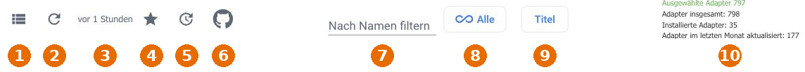
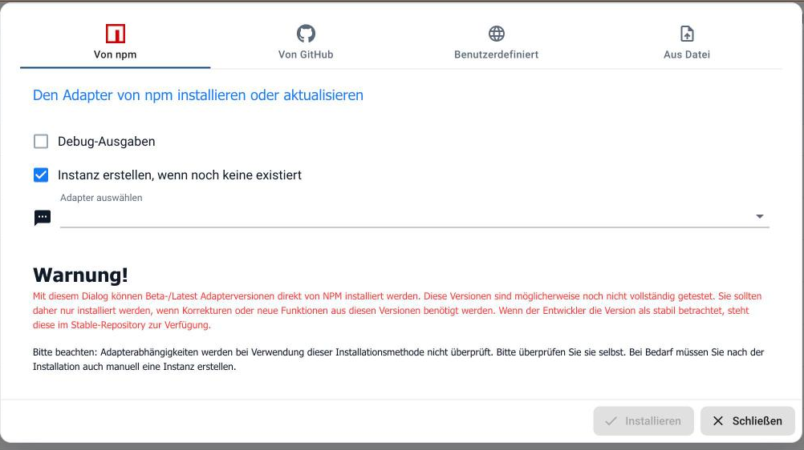
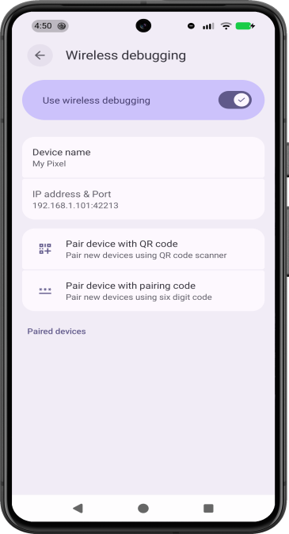
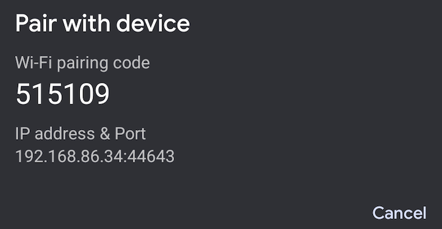

# VW-App in ioBroker installieren und einrichten

Mit `vw-app` bedient ioBroker die offizielle Volkswagen-App auf einem Android-Handy. Das Handy bleibt zu Hause im WLAN und am Ladegerät. Die Anmeldung bei Volkswagen erfolgt auf dem Handy.

**Stand: 25. Oktober 2026, Adapter 0.11.0.** Die Installation aus GitHub ist bereits möglich. Die Aufnahme in die normale ioBroker-Adapterliste ist beantragt und noch nicht freigegeben.

[Einrichtungsanleitung als PDF herunterladen](https://github.com/Borilu/ioBroker.vw-app/releases/download/v0.9.2/VW-App-Installation-und-Kopplung.pdf) (PDF für 0.9.2, gleicher Kopplungsablauf) · [Projekt auf GitHub](https://github.com/Borilu/ioBroker.vw-app)

Nach der Einrichtung hilft die [Bedienungsanleitung mit vollständiger Datenpunktreferenz und Bedienfolgen](BEDIENUNG.de.md), auch [als PDF für 0.10.0](https://github.com/Borilu/ioBroker.vw-app/releases/download/v0.10.0/VW-App-Bedienungsanleitung.pdf). Dieses ältere PDF enthält die Lademodi noch nicht; die Online-Anleitung ist für 0.11.0 aktualisiert.

Die Screenshots stammen aus den offiziellen ioBroker- und Android-Anleitungen. Android zeigt hier englische Beispielansichten; Samsung und andere Hersteller können anders aussehen. **Alle abgebildeten Adressen, Ports und Codes sind Beispiele. Verwende immer die Angaben deines eigenen Handys.**

## Vor dem Start

- **ioBroker auf Linux x64 mit Intel- oder AMD-Prozessor.** Benötigt werden Node.js ab 22.19.0, js-controller ab 6.0.11 und Admin ab 7.6.20. Ein Raspberry Pi mit ARM-Prozessor gehört nicht zum hier beschriebenen einfachen Installationsweg.
- **Android-Handy mit Android 11 oder neuer und dem Menüpunkt „Drahtloses Debugging“.** Bewährt ist die Kombination Galaxy A31, Android 12, deutsche Volkswagen-App 4.8.1 und ID.7 GTX Tourer. Andere App-Ansichten und Fahrzeuge sind gesondert zu prüfen.
- **Volkswagen-App eingerichtet.** Melde dich an und prüfe, ob du dein Fahrzeug bereits manuell über die App bedienen kannst. Erforderliche Volkswagen-Dienste müssen für dein Fahrzeug verfügbar sein.
- **Erreichbares Heimnetz und Internetzugang.** Handy und ioBroker müssen miteinander kommunizieren können. Die VM darf per Netzwerkkabel angebunden sein. Gast-WLAN und abgeschottete Netze können die Verbindung verhindern.
- **Ein Ladegerät für den dauerhaften Betrieb.** Ein USB-Kabel zur VM ist nicht erforderlich.

Für die Grundeinrichtung brauchst du weder dein Volkswagen-Passwort noch die S-PIN in ioBroker einzutragen.

## 1 Den Adapter installieren

### Jetzt aus GitHub installieren

1. Öffne die ioBroker-Verwaltung im Browser und gehe zu **Adapter**.
2. Aktiviere bei Bedarf den **Expertenmodus**, falls das Symbol für eigene Quellen fehlt.
3. Klicke oben auf das **Octocat-Symbol** für **Aus eigener Quelle installieren**. Im folgenden Bild ist es mit **6** markiert.



4. Wähle im geöffneten Dialog **Benutzerdefiniert**. Der Screenshot zeigt den gleichen Dialog zunächst mit dem Reiter „Von npm“.



5. Trage diese Adresse für die veröffentlichte Version 0.11.0 ein:

   ```text
   https://github.com/Borilu/ioBroker.vw-app/tree/v0.11.0
   ```

6. Lass **Instanz erstellen, wenn noch keine existiert** eingeschaltet und starte **Installieren**. Warte, bis ioBroker die Installation abgeschlossen hat.
7. Öffne **Instanzen** und dort die Einstellungen von **vw-app.0**. Falls keine Instanz vorhanden ist, füge auf der Adapterkachel eine hinzu. Starte die Instanz, falls sie ausgeschaltet ist.

Bei einer Installation aus eigener Quelle prüft ioBroker die Adapter-Abhängigkeiten nicht vollständig. Prüfe deshalb die Voraussetzungen oben vor der Installation. Der Reiter **Von GitHub** kann einen aktuellen Entwicklungsstand installieren; der feste Versionslink oben wählt gezielt 0.11.0.

### Später aus der normalen Adapterliste installieren

Dieser Weg funktioniert erst nach der Aufnahme in das verwendete Adapterverzeichnis:

1. Öffne **Adapter** und aktualisiere die Adapterliste.
2. Suche nach **vw-app**.
3. Öffne das Menü der Kachel und wähle **Instanz hinzufügen**. ioBroker installiert dabei den Adapter, falls er noch fehlt.
4. Öffne anschließend unter **Instanzen** die Einstellungen von **vw-app.0**.

Eine Freigabe für **Latest/Beta** macht den Adapter zunächst nur in diesem Verzeichnis sichtbar. Die Aufnahme in **Stable** erfolgt separat. Lege bei einer bereits vorhandenen Installation keine zweite Instanz für dasselbe Handy an.

## 2 Das Android-Handy vorbereiten

1. Verbinde das Handy mit deinem Heim-WLAN.
2. Öffne bei Samsung **Einstellungen → Telefoninfo → Softwareinformationen**.
3. Tippe **siebenmal auf Buildnummer** und bestätige gegebenenfalls die Bildschirmsperre.
4. Gehe zurück in die Einstellungen und öffne **Entwickleroptionen → Drahtloses Debugging**.
5. Schalte **Drahtloses Debugging** ein. Erlaube die Verbindung für dein eigenes vertrauenswürdiges WLAN, wenn Android danach fragt.



**Orientierung im Bild:** „IP address & Port“ bezeichnet die Adresse für die spätere Verbindung. „Pair device with pairing code“ öffnet die einmalige Kopplung. Bei Samsung heißen diese Punkte sinngemäß **IP-Adresse und Port** sowie **Gerät mit Kopplungscode koppeln**.

## 3 Die Android-Werkzeuge im Adapter einrichten

1. Öffne die Einstellungen von **vw-app.0**. Die Instanz muss laufen; eine Handyverbindung ist dafür noch nicht nötig.
2. Setze **Automatische App-Abfragen: Mindestabstand je Bereich** für die Einrichtung vorübergehend auf **0**. Speichere und warte den Neustart der Instanz ab. Öffne die Einstellungen anschließend wieder.
3. Lass **Android-Werkzeuge für diese Instanz verwenden** eingeschaltet.
4. Öffne den Link zur **Google-SDK-Lizenz**. Wenn du zustimmst, aktiviere **Ich habe die Google-SDK-Lizenz gelesen und akzeptiere sie**.
5. Klicke auf **Android-Werkzeuge herunterladen und installieren** und warte auf die Erfolgsmeldung.

Damit stellt der Adapter seine benötigten Werkzeuge selbst bereit. Ein zusätzliches Steuerprogramm auf der VM ist nicht erforderlich. Das bloße Einschalten der Werkzeug-Option startet noch keinen Download.

## 4 Das Handy einmalig koppeln

**Kopplungsport und Verbindungsport sind zwei verschiedene Werte.** Die Zahl hinter dem Doppelpunkt ist jeweils der Port.

| Angabe auf dem Handy | Feld in den Adaptereinstellungen |
| --- | --- |
| IP-Adresse ohne den Teil hinter dem Doppelpunkt | **IP-Adresse des Android-Handys** |
| Port im geöffneten Kopplungscode-Dialog | **Kopplungsport aus dem Code-Dialog** |
| Sechs Ziffern im Kopplungscode-Dialog | **Sechsstelliger Kopplungscode** |
| Port auf der Hauptseite von Drahtloses Debugging | **Verbindungsport auf der Hauptseite** |

1. Trage die **IP-Adresse des Handys ohne Port** im Adapter ein.
2. Öffne auf dem Handy **Gerät mit Kopplungscode koppeln** und lass diesen Dialog offen.



Dieses Bild und das Bild der Hauptseite stammen von verschiedenen Beispielgeräten. Übernimm keine der gezeigten Zahlen.

3. Trage den **Kopplungsport** und den **sechsstelligen Code** aus deinem offenen Handy-Dialog in die passenden Adapterfelder ein. Führende Nullen gehören zum Code.
4. Klicke auf **Jetzt mit dem Handy koppeln**, solange der Dialog auf dem Handy geöffnet ist. Warte auf die Erfolgsmeldung.
5. Schließe auf dem Handy **nur den Kopplungscode-Dialog**. Lass drahtloses Debugging eingeschaltet.
6. Lies auf dessen Hauptseite den **Verbindungsport** ab. Trage ihn unter **Verbindungsport auf der Hauptseite** ein und **speichere** die Adaptereinstellungen.
7. Warte den Neustart ab, öffne die Einstellungen wieder und klicke auf **Verbindung und App-Version prüfen**.

Der Kopplungscode wird nicht dauerhaft als Adaptereinstellung gespeichert. Leere sein Feld nach erfolgreicher Kopplung oder schließe das Formular.

## 5 Das Display beim Laden eingeschaltet lassen

1. Stecke das Handy ans Ladegerät und entsperre es.
2. Klicke in den Adaptereinstellungen auf **Beim Laden wachhalten jetzt aktivieren**.
3. Aktiviere zusätzlich **Handy bei Verbindung am Ladekabel wachhalten** und speichere.

Das Display bleibt damit beim Laden eingeschaltet. Nach einem Neustart oder einer manuell aktivierten Bildschirmsperre musst du das Handy weiterhin selbst entsperren.

## 6 Die Volkswagen-App und das Fahrzeug übernehmen

1. Entsperre das Handy und öffne die **Volkswagen-App**.
2. Wähle das gewünschte Fahrzeug und öffne dessen **Startseite beziehungsweise Fahrzeugübersicht**. Schließe offene Dialoge.
3. Klicke in den Adaptereinstellungen auf **App und Fahrzeug übernehmen**.
4. Prüfe die vorgeschlagene **Geprüfte Volkswagen-App-Version** und den **Vollständigen Fahrzeugtext aus der App**. Es muss dein gewünschtes Fahrzeug sein.
5. **Speichere** die Einstellungen und warte den Neustart ab.

„Verbindung und App-Version prüfen“ allein ersetzt diesen Schritt nicht. Der Adapter benötigt die ausdrückliche Übernahme von App und Fahrzeug.

## 7 Zuerst das Lesen prüfen

1. Öffne in ioBroker **Objekte → vw-app.0 → commands**.
2. Betätige **refreshCharging** einmal. Falls ein Werte-Dialog erscheint, schreibe **true** und lass **Bestätigt / ack** ausgeschaltet.
3. Warte, bis der Auftrag abgeschlossen ist. Gehe dann zu **Objekte → vw-app.0 → battery**. Vergleiche dort **soc** und **rangeKm** mit dem Ladestand und der Restreichweite in der Volkswagen-App.
4. Öffne wieder die Adaptereinstellungen und setze **Automatische App-Abfragen: Mindestabstand je Bereich** auf **15**. Speichere.

**15 Sekunden sind der Mindestabstand je Bereich nach dessen letzter Abfrage.** Der Adapter arbeitet die Bereiche nacheinander ab; ein kompletter Durchlauf kann deutlich länger dauern. Lass **App-Auslesung als veraltet markieren nach** zunächst auf **0 = automatisch**.

Die Werte stammen aus der App. Ein frisch ausgelesener App-Wert muss noch keine neue Messung am Auto sein. Regelmäßiges Lesen übernimmt keine gespeicherten Änderungswünsche und startet keine Klimatisierung.

Unter **vehicleInfo.vin** findest du außerdem die FIN des ausgewählten Fahrzeugs. Sie wird regelmäßig aus „Meine Fahrzeuge“ gelesen. Mit **commands.refreshVehicleInfo** lässt sie sich auch gezielt abfragen; **vehicleInfo.observedAt** zeigt die letzte erfolgreiche App-Auslesung.

## 8 Bei Bedarf die Bedienung freigeben

Für Klima- und Einstellungsänderungen aktiviere **Klimastart, Stopp und Änderungen der Fahrzeugeinstellungen erlauben** und speichere. Erst diese Freigabe erlaubt tatsächliche Änderungen. Starte den ersten Klimatest bewusst und prüfe die Rückmeldung in App und Fahrzeug; die Ausführung kann etwas dauern.

**Verriegeln und Entriegeln sind optional:** Beide Funktionen müssen bereits manuell in deiner Volkswagen-App funktionieren. Trage die vierstellige **Volkswagen S-PIN ausschließlich im maskierten Feld der Adaptereinstellungen** ein und aktiviere **Fahrzeug verriegeln und entriegeln erlauben**. Speichere anschließend. Die S-PIN gehört niemals in Skripte, Chatnachrichten oder öffentliche Screenshots. Administratoren deines ioBroker-Systems können auf sensible Konfigurationen zugreifen; gib keine Konfigurations- oder Konsolenmitschnitte mit hinterlegter PIN weiter.

Eine unklare Befehlsrückmeldung ist kein Anlass, den Befehl wiederholt zu drücken. Prüfe zuerst die Volkswagen-App und den tatsächlichen Fahrzeugzustand.

## Updates und häufige Fragen

**Adapter aktualisieren:** Nach der Aufnahme in dein verwendetes Verzeichnis werden verfügbare Updates auf der Adapterseite angeboten. Bis dahin installierst du die gewünschte veröffentlichte Version erneut über **Aus eigener Quelle → Benutzerdefiniert**, mit dem passenden Versionslink aus den GitHub-Releases. Die vorhandene Instanz bleibt bestehen; füge für ein Update keine neue hinzu.

**Volkswagen-App aktualisiert:** Öffne die Fahrzeugübersicht und führe **App und Fahrzeug übernehmen** erneut aus. Geänderte Ansichten können eine Anpassung des Adapters erfordern.

| Problem | Was du prüfen solltest |
| --- | --- |
| vw-app fehlt in der Adapterliste | Bis zur Verzeichnisfreigabe den GitHub-Weg aus Schritt 1 verwenden. |
| Einrichtungsschaltflächen antworten nicht | Läuft die Instanz? Dauerhafte Einstellungen speichern und den Neustart abwarten. |
| Kopplung schlägt fehl | Kopplungscode-Dialog offen halten; aktuellen Code und dessen Kopplungsport verwenden. |
| Gekoppelt, aber keine Verbindung | Den anderen Port von der Hauptseite übernehmen, speichern und die Verbindung prüfen. |
| Nach Handyneustart keine Verbindung | Handy entsperren und aktuellen Verbindungsport prüfen. Er kann sich ändern. Nur bei verlorener Kopplung erneut koppeln. |
| Handy ist im WLAN, aber unerreichbar | Gast-WLAN, Geräteisolation, VM-Netz und Firewall prüfen. Keine Portfreigabe ins Internet einrichten. |
| App lässt sich nicht auslesen | Handy entsperren, Fahrzeugübersicht öffnen, offene Dialoge schließen und App/Fahrzeug erneut übernehmen. |
| Display wird dunkel | Ladegerät angeschlossen? Wachhalten aus Schritt 5 aktiviert? Eine Bildschirmsperre selbst entsperren. |
| Werte ändern sich verzögert | Die App kann ältere Fahrzeugdaten anzeigen; zusätzlich benötigt der vollständige Adapter-Rundlauf Zeit. |

## Weiterführende Hilfe und Bildnachweise

- [Ausführliche Adapterbeschreibung und Datenpunkte](ADMIN-SETUP.md)
- [ioBroker Anleitung zur Adapterseite und Installation aus eigener Quelle](https://www.iobroker.com/docs/admin/adapter.md?lang=de)
- [Android Anleitung für drahtloses Debugging](https://developer.android.com/tools/adb#wireless-android11)
- [Android Entwickleroptionen](https://developer.android.com/studio/debug/dev-options)
- [Veröffentlichte Versionen](https://github.com/Borilu/ioBroker.vw-app/releases)
- [Fehler melden](https://github.com/Borilu/ioBroker.vw-app/issues) - ohne S-PIN, Kopplungscode oder private Fahrzeugdaten.

Die beiden ioBroker-Screenshots stammen von **ioBroker.docs**, Copyright (c) 2014-2026 bluefox, MIT-Lizenz. Die Android-Screenshots stammen aus der Dokumentation von **Android Developers / Android Open Source Project**, Apache License 2.0. Die Bilder sind unverändert. [Genaue Bildquellen](images/setup/SOURCES.md) und [vollständige Lizenztexte](images/setup/LICENSES.txt) liegen bei. Im PDF sind die Lizenztexte zusätzlich als Dateianlage enthalten.
